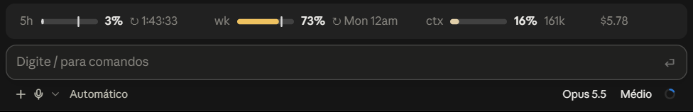
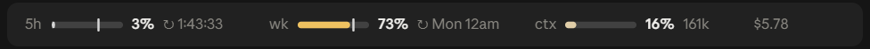
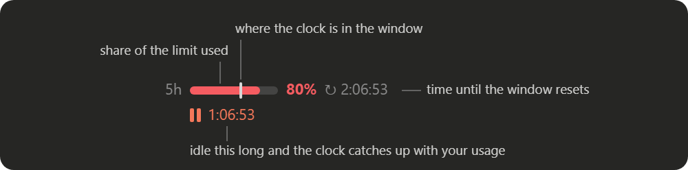

# burnline-band

A Claude Code plugin that draws [Burnline](https://github.com/Vijeth-Rai/burnline)'s usage line as a band above the prompt in the Claude desktop app.



## What it shows



- `5h` and `wk` are your 5-hour and 7-day rate limits: how much you have used, and when each window resets.
- `ctx` is how full the context window is, with the token count next to it.
- The dollar figure is the session's cost so far.

The countdowns tick every second while you work. The bars, percentages, context and cost are checked every 15 seconds and at the end of each turn, and the band redraws only when one of them has changed. A redraw makes the desktop app rebuild what other plugins drew, and their hover highlights blink when that happens, so the band asks for as few as it can. The band only draws in the desktop app. In a terminal session the plugin steps aside and your status line stays as it was.

## What it is for

Burnline is a statusline command, and the statusline is a terminal feature. This plugin puts the same reading in the desktop app's Code tab, where you can tell at a glance whether you are spending a limit faster than its window is passing.

## Reading a meter



*This one is an illustration, drawn with the values the plugin produces for 80% used when about 58% of the window has passed. The two images above are screenshots.*

Each rate-limit meter carries two readings. The filled part is the share of the limit you have used. The vertical tick is the clock: how far the window has run toward its reset.

When the fill stops short of the tick, you are using the limit slower than time is passing. When it runs past the tick, you will hit the limit before the reset if you keep the same pace.

The color follows that gap. A fill well behind the clock is grey. It turns amber as usage catches up with the clock and coral once usage is about 25 points ahead of it. The percentage takes the same color from amber onward.

`↻` is the reset. Under a day away, it is a live `H:MM:SS` countdown. Further out, it is the day and hour, such as `Mon 12am`.

A second row with a pause icon appears when usage is more than 5 points ahead of the clock. It says how long you would have to stop for the clock to catch up.

`ctx` has no window, so it has no tick, and its color follows the fill alone.

## Install

Run this in a shell. The desktop app's Terminal panel works:

```sh
claude plugin install burnline-band --marketplace brunofgmag/burnline-band
```

It installs at the user scope, and the band shows up in the desktop sessions you start afterwards.

From inside a terminal `claude` session you can type the slash command instead:

```
/plugin install burnline-band --marketplace brunofgmag/burnline-band
```

Answer `y` when it asks to add the marketplace, then pick the user scope. Typing that slash command at the desktop app's prompt does not install anything. The app opens its plugin catalog, which does not list this repository.

The plugin was written and tested on Claude Code 2.1.296. It needs a build that loads plugin hooks modules.

Until Claude Code has a usage reading for the session, the band says `Waiting for the first usage reading`. If your account reports no 5-hour or weekly limit, the band shows `ctx` and the cost.

## Running from source

```sh
git clone https://github.com/brunofgmag/burnline-band.git
claude --plugin-dir ./burnline-band
```

To load it in every session, including the desktop app's, put the folder's path in the `CLAUDE_CODE_PLUGIN_DIRS` environment variable.

```sh
claude plugin validate .
claude plugin test .
```

The first command checks the manifest and lists what the module hooks and calls. The second runs the tests in `tests/`.

## Based on Burnline

The layout, the tick for the clock, the `↻` and pause readings, and the amber and coral colors all come from [Burnline](https://github.com/Vijeth-Rai/burnline) by Vijeth-Rai, a statusline for the Claude Code terminal. If you work in the terminal, use that one. Both can be installed together, since this plugin leaves the terminal alone.

A few things differ. The bars are SVG instead of block characters, so they do not depend on your font. The low end of the color scale is grey where Burnline uses mint. The band leaves out the model name, which the desktop app already shows under the prompt.

## Privacy

The plugin reads the session's usage from Claude Code and the clock, and it draws. It makes no network requests and stores nothing. `claude plugin validate .` prints the full list of calls it makes.

## License

MIT. See [LICENSE](LICENSE).
